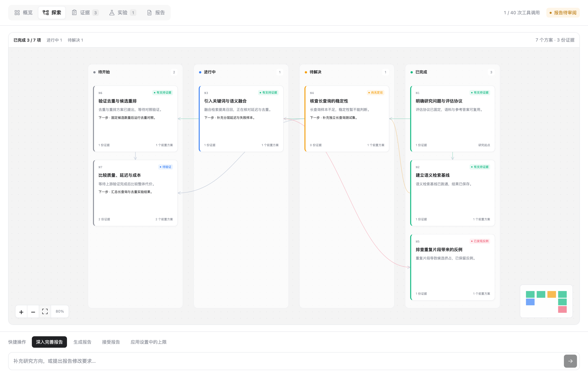
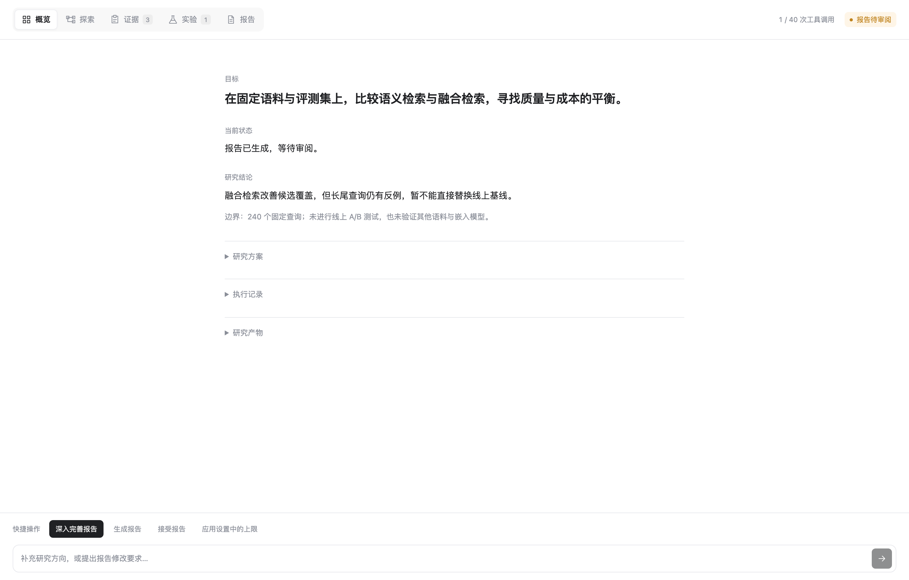
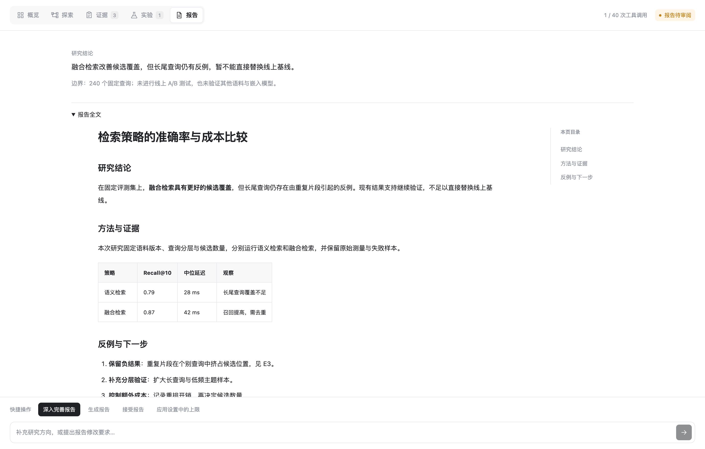
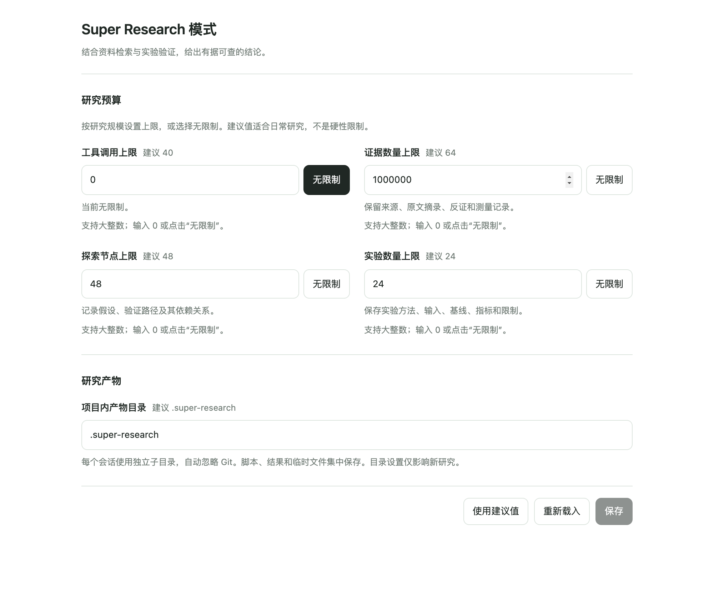

# Super Research

DSH 原生研究插件 `dsh-super-research`，提供 **Super Research 模式** 和会话顶部的 **研究实验** 页面。结合资料检索与实验验证，开展通用研究、算法分析和离线量化，给出有据可查的结论。

[安装与使用](#使用) · [设置与产物](#设置与产物) · [下载插件](https://github.com/ArtlexYoung/dsh-super-research/releases/latest)

## 界面预览

以下截图来自实际插件界面，使用 DSH 0.2.1-rc.2 的渲染组件和演示研究数据；图中的指标与结论仅用于展示交互。

**探索：图与进度看板结合。** 按待开始、进行中、待解决、已完成查看不同方案，连线保留依赖关系；支持滚轮缩放、拖动和查看节点证据。



**概览：几句话掌握研究。** 目标、当前状态与模型总结直接展示，方案、执行记录和产物按需展开。



**报告：结论先行，依据可查。** 原处展开完整报告，保留方法、对照表、反例与限制，也可直接要求深入完善。



**设置：按研究规模调整。** 每项上限附建议值，支持大整数与无限制，研究产物集中到项目内独立目录。



## 使用

要求 DSH **0.2.1-rc.2** 的预设声明、会话投影和右侧栏接口，以及其文件、联网、Shell 和技能服务。当前版本只验证了这一宿主版本。

从 [GitHub Releases](https://github.com/ArtlexYoung/dsh-super-research/releases) 下载 `dsh-super-research-0.0.1.tgz`，在 DSH 桌面版的“插件 → 添加插件 → 包名或地址”中填入包的绝对路径进行安装。也可克隆源码后运行 `npm pack` 生成安装包。插件由 `cordis.patch.yml` 声明宿主视图和研究预设。npm 包需由维护者另行发布，发布后可使用 `dsh-super-research@0.0.1` 安装。

安装并启用插件后，创建会话时选择 **Super Research 模式**。仅选择此模式的会话会在顶部“对话”右侧显示 **研究实验**；普通会话不显示，空白研究会话选好模式后也可进入。该标签打开独立研究工作台，默认概览用几句话交代目标、当前状态和研究结论；研究方案、执行记录与研究产物可在原处展开。探索页直接展示关系图，支持以鼠标位置为中心的滚轮缩放、拖动、适应画布、缩略图定位和节点证据查看。证据与实验页直接展示各自列表，支持搜索、筛选和就地展开原始记录。报告页先显示结论，报告全文在原处展开，使用 DSH 原生 Markdown 排版，宽屏提供目录跳转，正文独立滚动。各页不增加“查看/返回”导航，普通记录更新保留已展开的全文。底部保留“快捷操作”和补充输入。进入此页后隐藏通用聊天输入框，保留 DSH 的权限和提问弹层；切回“对话”即恢复聊天输入。右侧栏另保留紧凑的研究视图。本源码目录不会自动修改桌面配置。

研究结束时，模型需用两三句简短文字总结主要结论与重要限制，保存到报告的 `summary`，并在最后的对话回复中给出同样的总结。概览和报告页直接展示这份模型总结，不从长报告截取；导出的 `report.md` 同样包含总结。研究继续进行时标为上一版结论，尚无报告时不推断结论。旧报告保留原文并提示尚无简要总结，下次更新报告时由模型补上。

探索页将依赖图与进度看板放在同一画布中：**待开始、进行中、待解决、已完成**分别成列，方案或验证任务以卡片展示当前进展、下一步和证据数量，连线保留前置关系。点击卡片会突出关联连线并打开详情，缩放、拖动和缩略图定位仍可使用。首次展示优先保证文字可读，较大的看板可拖动浏览或点击“适应画布”总览。模型通过节点的 `progress` 和 `node_update` 更新同一张卡片，进度变化不会复制节点或重置画布位置。阶段可以直接调整、重新开启，不要求逐列执行。

执行进度与验证结果分别记录：“已完成”只表示该项工作告一段落，结果仍可能有反例或尚无定论。顶部完成数量仅统计明确标注进度的卡片，不按工具调用次数推算百分比。旧节点保留在“未标注进度”区域，展示原有结论与依据；下次研究时，模型核对记录后可补充进度。不会把旧记录的“有支持证据”自动改成“已完成”。进度随研究记录持久化，并写入独立产物目录中的 `exploration.json` 和 `study.json`。

1. 在对话中提出要分析、比较或验证的问题，补充必要的材料、范围和验收标准。无需“研究”关键词。
2. 模型先保存并展示方案；需要修改就直接说明。点击 **确认并开始**，或自然回复“好，按这个方案开始”，即可执行，不要求固定口令。
3. 研究使用 DSH 提供的工具和权限。实验页呈现来源原文、反例、探索关系与实验记录；可点击 **生成报告**、**停止执行** 等常用按钮。
4. 报告生成后点击 **深入完善报告**，或在对话/实验页直接描述修改要求，模型会在同一轮继续研究并更新报告，无需再发“继续研究”。满意后点击 **接受报告**；模型不能自行验收。

切换或重新打开会话会恢复研究视图。中断的工作不会自动重放；点击 **继续研究** 或提出具体下一步要求即可继续，先核对未知结果，不自动重放调用。发送按钮会立即显示发送中，回答时变为带执行指示的停止按钮；点击可使用 DSH 原生取消，请求尚在确认时也可停止已经开始的执行。发送成功不增加底部提示或挤压正文；失败保留明确错误和输入。研究记录中的暂停只阻止后续调度。

更新插件后请在 DSH 设置中重启应用，使后台配置校验与新界面同时生效；旧后台可能拒绝“无限制”或较大上限。

只打开工作台不会切换会话模式。如果一直显示“等待研究问题”，先检查会话是否选择了该模式，以及生成方案的轮次是否被停止。仅在聊天中写出计划、尚未调用 `super_research` 保存方案时，侧栏不会创建研究。资料读取、检索和实验都在确认方案后开始。

## 设置与产物

打开 DSH 的 **设置 → Super Research 模式**，可以配置：

| 配置 | 默认/建议值 | 范围 |
| --- | --- | --- |
| 项目内产物目录 | `.super-research` | 单个目录名，支持字母、数字、点、下划线、短横线；不允许路径跳转或 `.git`、`node_modules` |
| 工具调用上限 | 40 | 正整数或无限制 |
| 证据数量上限 | 64 | 正整数或无限制 |
| 探索节点上限 | 48 | 正整数或无限制 |
| 实验数量上限 | 24 | 正整数或无限制 |

设置页采用与 Super Code 一致的分组、双列输入、建议值和底部保存操作。所有数量支持最高 `9,007,199,254,740,991` 的安全整数，例如一百万、十亿；点击“无限制”或输入 `0` 可取消该项数量限制。建议值用于日常研究，不限制可设置的规模。

设置保存在 DSH 当前配置档中。新研究采用当前配置；已有研究点击实验页的 **应用设置中的上限**，即可更新四项上限，不清空记录，也不迁移产物。该按钮只更新上限，继续工作可点击 **深入完善报告** 或提出具体要求；也可在一次自然语言请求中同时要求调整预算并继续研究。产物目录在研究创建时固定，之后的目录设置只影响新研究。此前本地预览版（0.1.0/0.1.1）的已有记录保留，不重跑工具。

默认布局如下，`study-…` 由会话 ID 稳定生成，避免不同会话互相覆盖；切换工作目录不会移动研究：

```text
<原项目>/.super-research/
  .gitignore                 # 忽略本目录全部内容，包括自身
  .super-research.json        # 插件目录标识
  study-<会话标识>/
    .super-research.json      # 会话归属标识
    README.md
    proposal.md
    evidence.json
    exploration.json
    experiments.json
    operations.json
    study.json
    report.md                # 生成报告后出现
    scripts/                 # 按需创建：实验脚本
    outputs/                 # 按需创建：数据副本、结果
    tmp/                     # 按需创建：临时文件
```

研究记录在宿主持久化成功后导出，完整 `study.json` 最后写入。导出失败会明确报错并阻止后续外部工具；用 `super_research read` 重试即可，不会重复记录或重放实验。DSH 会话记录仍是恢复来源，自动导出的文件通过对话修订；已有文件不自动搬迁。

插件不认领已有的非空普通目录，也拒绝导出路径中的符号链接。文件写入与编辑只能落在本项研究的 `scripts/`、`outputs/`、`tmp/` 中；Shell 必须显式使用研究目录作为工作目录，源材料通过绝对路径读取。Shell 程序仍受 DSH 权限约束，插件不解析任意命令来保证操作系统级隔离。只读模式无法导出，需要用户在 DSH 中允许工作区写入后重试。无需修改项目顶层 `.gitignore` 或全局 Git 配置。

## 能力

- 通用研究：来源引用、原文摘录、用户材料、反证和不确定性。
- 算法研究：假设及依赖、反例、可复现方法、输入、基线、候选与测量记录。
- 离线量化：确认后固定数据、划分、指标和成本协议，拒绝记录不匹配协议的实验。
- 执行控制：方案版本、明确确认、调用预算、幂等写入、保存失败暂停、未知结果保留。
- 实验页：随会话模式显示的顶部入口、快捷操作按钮、自由补充要求，以及概览、探索、证据、实验、报告视图；跟随当前会话。

模型、凭据、检索、文件访问、Shell 权限、取消和会话存储由 DSH 提供。本包不创建模型客户端、聊天数据库、独立网页服务或常驻执行器；不自动创建子代理团队。研究工具和提示只在研究预设内生效。仅支持通用研究、算法与离线量化，不提供攻击、渗透或交易执行能力。

## 记录与限制

`super_research` 提供读取研究、查看原始事件和提交研究记录的能力。宿主在外部工具执行前保存预算预留，执行后保存结果状态；失败也消耗预算。工具、证据、探索和实验分别遵循可调整的上限，`0` 表示无限制；新版不再有隐藏的 100 次操作、512 条请求或 256 KB 研究总量限制。单条写入和一次原始来源读取分别最多 64 KB；单条证据/报告仍有长度约束。无限制指插件不设数量上限，实际执行仍受 DSH、模型上下文、磁盘与内存资源约束。

新写入使用 v2 事件，保留 v1 的重放语义和快照校验。报告修改会直接进入执行状态，并保留上一版报告直到新报告保存；已验收报告也可按新的用户要求继续完善。确认、续研、审阅和调整上限都引用本会话最新的完整直接用户消息，不允许模型伪造用户验收。

证据摘录必须存在于本会话的成功工具结果中；用户提供的材料单独标识。实验完成记录需要测量证据。引用检查证明记录可追溯，不能自动证明来源真实、算法正确或策略有效；判断仍需检查原始工具、方法和数据。基线、候选和指标在本版按实验记录保存，不执行自动统计显著性检验或策略选择。

研究状态使用 DSH 的实验性 `appendPluginRecord` 接口写入版本化完整快照，由宿主会话投影恢复。该接口的跨格式迁移只提供尽力保留；未知或损坏记录会禁用该会话的研究执行。跨 DSH 版本升级前需要另行验证。本版不提供独立备份库，也不会因重新加载视图而恢复执行。

在已验证的桌面宿主上，切换研究会话与普通会话时曾观察到短暂的 `uiConversation.binding: unknown session` 错误，页面随后恢复；触发原因尚未完全隔离。研究记录与设置在验证中保持不变。

## 开发与验证

源码直接运行，不需要构建产物：

```bash
git clone https://github.com/ArtlexYoung/dsh-super-research.git
cd dsh-super-research
npm ci --ignore-scripts
npm run check
npm test
npm run pack:check
```

浏览器测试使用本机 Chromium；可通过 `BROWSER_EXECUTABLE` 指定可执行文件。找不到浏览器时该项会明确跳过。测试包含真实 DSH Loader、官方配置服务的保存及冲突检查、完整预设声明与官方 JSONL 持久化读取、产物隔离及导出恢复，以及真实浏览器中的组件交互；浏览器回归会从已安装 DSH 的 `app.asar` 加载实际 React、Markdown 与 Slot renderer，验证 selector Hook、订阅、页面/侧栏、原生审批保留、聊天输入恢复、图交互、证据筛选及报告排版；会话传输与外围布局使用夹具。可用 `DSH_APP_ASAR` 指定宿主归档；缺少宿主时该项明确跳过。浏览器回归并不替代真实桌面验收。测试不调用付费模型，不验证真实检索服务或量化收益。

工作台的紧凑任务头、分段标签、探索画布与记录列表参考 ARTEX 的可见布局；插件界面代码、样式和图标独立实现，未复制其前端代码或资源。

公开展示截图保存在 `docs/screenshots/`，本地计划和验证截图保存在 `.development/`；两者均不进入 npm 包。Apache-2.0。
